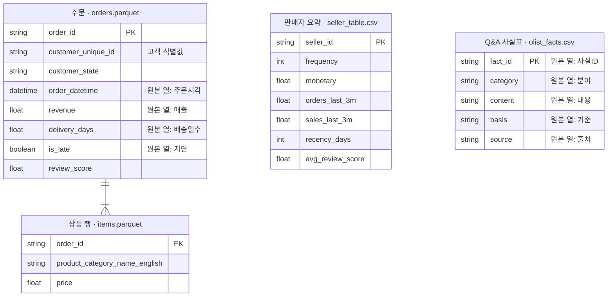

# Olist 브라질 이커머스 대시보드

브라질 Olist의 공개 전자상거래 데이터를 분석하고, 저장된 머신러닝 모델로 리뷰 감성·상품 유사도·판매자 유형·이탈 위험을 살펴보는 Streamlit 학습용 앱입니다. 분석 Q&A에서는 사실표와 설명서에서 근거를 찾아 답변합니다.

이 저장소는 **전처리된 데이터와 사전 학습 모델을 사용하는 로컬 앱**입니다. 원본 CSV 수집·전처리·모델 재학습 노트북은 포함되어 있지 않습니다.

## 주요 기능

| 메뉴 | 구현 내용 |
|---|---|
| 홈 | 프로젝트와 모델 안내 |
| 데이터 분석 | 고객 지역·월 범위 필터, 주문·매출·배송·리뷰 지표, 주문 금액·별점 분포, 첫 주문 월별 재주문 코호트와 CSV 다운로드 |
| 리뷰 감성 분석 | 포르투갈어 리뷰를 TF-IDF + 로지스틱 회귀로 긍정·부정 분류 |
| 상품 추천 | 같은 카테고리 안에서 특징이 비슷한 상품 5개 검색 |
| 판매자 유형 | 주문 수·판매액·활동 기간·평점으로 4가지 군집 유형 판정 |
| 판매자 이탈 위험 | 판매자별 이탈 추정값과 관리 우선순위 표시 |
| 분석 Q&A | 선택한 자료를 검색하고 근거 ID가 붙은 AI 답변 생성 |

`매출 추이` 탭의 주문 금액 누적 분포는 같은 양수 금액 주문을 선형 축과 로그 축에서 비교합니다. `배송·리뷰` 탭의 별점 누적 막대는 배송 상태별로 1~5점의 비율을 보여 줍니다. 분모는 각 집단에서 유효한 평점이 기록된 주문 수이며, 표에서 1~2점 주문 수와 비율을 확인할 수 있습니다.

데이터 분석 화면의 지역·기간 필터와 Q&A의 사실표는 별개입니다. **필터를 바꿔도 Q&A 사실표의 수치는 자동으로 다시 계산되지 않습니다.**

`재주문 코호트` 탭은 배송 완료 기록에서 고객별 첫 주문 월을 찾고, 이후 1~6개월의 월별 재주문율을 보여 줍니다. 기간은 첫 주문 월, 지역은 첫 주문의 고객 지역으로 고르고 이후 주문은 전체 저장 데이터에서 확인합니다. 한 달을 온전히 포함하지 않는 처음·마지막 달은 비교 범위에서 제외하며, 관찰이 끝나지 않은 칸은 비워 둡니다. 관찰 완료 후 재주문 고객이 없으면 0%로 표시합니다.

## 빠른 실행 — Windows 11 / PowerShell

Python 3.12와 Git을 준비하고, 작업할 상위 폴더에서 실행합니다. 예시의 `.venv-local`은 기존 환경과 구분하기 위한 새 가상환경입니다.

```powershell
git clone https://github.com/gamzpot96-cell/olist_dashboard.git
cd olist_dashboard
py -3.12 -m venv .venv-local
.\.venv-local\Scripts\python.exe -m pip install -r requirements.txt
.\.venv-local\Scripts\python.exe -m streamlit run app.py
```

정상 실행 시 표시되는 `Local URL`로 접속합니다. 기본 주소는 **http://localhost:8501**이며, 이미 사용 중인 포트가 있으면 터미널에 표시된 주소를 따릅니다. 앱을 사용하는 동안 터미널을 켜 두고, 종료할 때는 `Ctrl+C`를 누릅니다. 로컬 실행만으로 인터넷에 게시되지는 않습니다.

분석·머신러닝 화면에는 OpenAI API 키가 필요하지 않습니다. 분석 Q&A를 사용할 때만 본인의 키를 설정합니다.

## 데이터와 분석 범위

출처: [Brazilian E-Commerce Public Dataset by Olist — Kaggle](https://www.kaggle.com/datasets/olistbr/brazilian-ecommerce)

아래 수치는 저장소에 포함된 파일을 직접 읽어 확인한 값입니다. Olist 원본 전체의 규모와 구분해야 합니다.

| 파일 | 포함 내용 |
|---|---|
| `data/orders.parquet` | 배송 완료 분석 주문 **96,203건**, 주문 ID 중복 없음 |
| `data/items.parquet` | 분석 주문에 대응하는 상품 행 **109,872개** |
| `data/seller_table.csv` | 이탈 위험 조회에 사용하는 판매자 **1,817명**, 표의 전체 열 20개 |
| `data/olist_facts.csv` | 분석·모델 실습에서 정리한 사실 **35개**, `F01`~`F35` |
| `data/olist_model_guide.md` | 모델의 입력·처리 방식·한계 설명 |
| `data/olist_seller_policy.pdf` | **RAG 실습용 가상 판매자 규정집. 실제 Olist 정책이 아님** |

- 주문 시각 범위: **2017-01-05~2018-08-29**.
- `orders.parquet`의 매출 열 합계: **R$ 15,374,496.52**. 상품 행의 `price` 합계와는 집계 기준이 다릅니다.
- 기본 표본의 배송 기간 중앙값은 약 **10.2일**, 배송 지연율은 약 **8.13%**, 평균 리뷰는 약 **4.16점**입니다.
- 화면 지표는 선택한 지역·기간에 따라 바뀝니다. 사실표에는 현재 앱에서 직접 재계산하지 않는 과거 학습·평가 결과도 포함되어 있습니다.

## 데이터 관계도 (ERD)

이 앱은 관계형 데이터베이스 대신 Parquet·CSV 파일을 읽습니다. 아래 ERD는 **현재 저장된 파일의 열과 논리적 연결 관계**를 나타냅니다. `PK`는 파일 안에서 행을 구분하는 고유 키, `FK`는 다른 파일과 연결할 때 사용하는 열입니다. 데이터베이스가 키 제약을 강제하는 구조는 아닙니다. 도식에서 한글 열은 영문 별칭과 `원본 열` 주석으로 표시했습니다.

관계선에는 연결 기호만 표시하고, 연결 열과 의미는 도식 아래에서 설명합니다.



- `ORDERS` → `ITEMS`: `order_id`로 연결하며, 주문 **1건에 상품 행 1개 이상**이 대응합니다. 현재 파일에서 상품 행이 없는 주문과 주문을 찾을 수 없는 상품 행은 없음을 확인했습니다.
- `ITEMS`에는 개별 상품 ID·주문 내 순번이 없어 `order_id`만으로 상품 행을 고유하게 구분할 수 없습니다. 고객·리뷰 정보는 별도 테이블이 아니라 주문 파일에 포함되어 있습니다.
- 판매자 요약은 전체 20개 열 중 주요 열만 표시했습니다. 현재 주문·상품 파일에는 `seller_id`가 없어 판매자 요약과 직접 연결하는 선을 그리지 않았습니다.
- Q&A 사실표는 집계·학습 결과를 정리한 독립 자료입니다. 개별 주문·판매자의 외래 키는 없으며, 모델 설명서·가상 규정집은 검색용 문서입니다.

## 저장된 모델

| 파일 | 방식과 용도 | 해석할 때 주의할 점 |
|---|---|---|
| `model/part7_1_sentiment_ml.pkl` | TF-IDF + 로지스틱 회귀, 포르투갈어 리뷰 감성 | 학습 단어가 없는 문장에는 경고 표시. 한국어·영어 성능을 보장하지 않음 |
| `model/part6_recommend.pkl` | 카테고리별 KNN, 가격·무게·크기·사진 수·평점 비교 | 함께 구매한 상품이나 실제 구매 효과를 뜻하지 않음 |
| `model/part8_seller_segment.pkl` | K-Means, 판매자 4개 군집 | 유형 이름과 관리 방향은 군집에 붙인 해석 |
| `model/part9_seller_churn.pkl` | 전처리를 포함한 로지스틱 회귀 | 이탈은 **다음 3개월 유효 주문 0건**이라는 실습용 정의이며 폐업 판정이 아님 |

판매자 유형은 `핵심 우량`, `신규 성장`, `휴면`, `저평점 위험`입니다. 관리 우선순위에 쓰는 예상 손실은 **이탈 추정값 × 최근 3개월 판매액**으로 계산한 지표이며 실제 미래 손실액이 아닙니다. 판매자 표와 이탈 조회의 기준일은 **2018-08-23**입니다.

TensorFlow 감성 모델과 BERT 비교 실습은 모델 설명서에 언급되어 있지만, 이 웹앱이 불러오는 모델은 위의 **pkl 4개**입니다. 학습 당시 설정에 맞춰 `requirements.txt`에서 `numpy==2.4.6`, `scikit-learn==1.6.1`을 고정합니다.

## 분석 Q&A — API 사용

현재 Olist Q&A에는 타이타닉 앱의 무료 검색 모드가 없습니다. **자료 임베딩·질문 임베딩·답변 생성에 API 비용이 발생할 수 있습니다.**

| 채널 | 검색하는 자료 | 질문 예시 |
|---|---|---|
| A | 사실표 | 늦게 도착한 주문의 리뷰 점수는? |
| B | 사실표 + 모델 설명서 | 이탈 모델은 어떤 숫자를 보고 판단해? |
| C | 사실표 + 모델 설명서 + 가상 규정집 PDF | 배송이 3일 늦으면 고객은 무엇을 받을 수 있어? |

`utils/rag.py`의 현재 설정은 다음과 같습니다. 이는 코드에 지정된 값이며 계정별 사용 가능 여부와 최신 지원 상태는 별도로 확인해야 합니다.

- 문서·질문 임베딩: `text-embedding-3-small`
- 답변 생성: `gpt-5.4-mini`
- 저장소: LangChain `InMemoryVectorStore`, 선택한 채널의 유사 근거 최대 4개 검색
- 근거 검수: 검색하지 않은 근거 ID를 답변에서 발견하면 경고 표시

문서 저장소는 메모리에 만들어 캐시합니다. 앱을 다시 시작하거나 다른 채널을 초기화하면 문서 임베딩 요청이 다시 발생할 수 있습니다. 채널별 대화 기록은 세션에 표시하지만, 현재 API 요청에는 **현재 질문과 검색 근거만** 전달합니다.

키 확인 순서는 Streamlit secrets → `OPENAI_API_KEY` 환경변수 → Q&A의 키 입력란입니다. 화면 입력란을 사용하거나, 앱을 실행할 PowerShell에서 다음처럼 환경변수를 설정한 뒤 실행할 수 있습니다.

```powershell
$env:OPENAI_API_KEY = "본인의_API_키"
.\.venv-local\Scripts\python.exe -m streamlit run app.py
```

`.env` 파일을 자동으로 읽는 코드는 없습니다. API 키를 소스 코드·README·화면 캡처·Git 커밋에 포함하지 마세요. 근거 번호의 존재만으로 문장의 사실성이 보장되지는 않으므로 답변과 근거 원문을 대조해야 합니다.

## 코드 구성

| 경로 | 역할 |
|---|---|
| `app.py` | Streamlit 시작점과 메뉴 등록 |
| `views/` | 홈·분석·모델·Q&A의 7개 화면 |
| `utils/data.py` | 데이터 읽기, 필터, 지표와 그래프 |
| `utils/models.py` | 사전 학습 모델 읽기와 추론 |
| `utils/rag.py` | 문서 구성, 임베딩 검색, AI 답변과 근거 ID 확인 |
| `data/`, `model/` | 실행에 필요한 데이터·근거 자료·모델 |
| `requirements.txt` | 실행 의존성 |

## 오류 확인과 검증 범위

| 상황 | 확인할 내용 |
|---|---|
| `No module named 'langchain_core'` 등 | 앱을 실행하는 **같은 가상환경의 Python**으로 `-m pip install -r requirements.txt` 실행 |
| Parquet·CSV·pkl 파일을 찾지 못함 | `data/`, `model/`을 포함해 저장소를 내려받았는지 확인 |
| 모델 버전 관련 경고·오류 | 고정된 NumPy·scikit-learn 버전과 학습 환경 확인. 재학습 노트북은 이 저장소에 없음 |
| Q&A 인증·모델·요금 오류 | 본인 API 키·계정 권한·사용량 한도와 `utils/rag.py`의 모델 설정 확인 |

README 작성 시 소스 구문, 파일 구성, 주문·상품·판매자 데이터 규모와 집계값을 확인했습니다. **이번 문서 점검에서 Windows 새 설치, 모델 4개의 추론, 유료 API 응답을 다시 실행·검증한 것은 아닙니다.** 모델 성능 수치는 사실표에 기록된 과거 실습 결과와 구분해서 사용해야 합니다.

자동 해설에는 관리 제안과 해석이 포함됩니다. 배송·평점·판매 실적 사이의 관찰 차이를 원인으로 단정하거나, 판매자에게 불이익을 주는 실제 의사결정에 그대로 적용하지 마세요.

## 출처와 이용 조건

- 원본 데이터 제공: [Olist / Kaggle](https://www.kaggle.com/datasets/olistbr/brazilian-ecommerce). README 작성 시 Kaggle 메타정보의 데이터 라이선스는 **CC BY-NC-SA 4.0**으로 확인했습니다. [라이선스 원문](https://creativecommons.org/licenses/by-nc-sa/4.0/)과 원본 페이지의 조건을 확인하세요.
- `olist_seller_policy.pdf`는 실습용 창작 규정이며 실제 업체의 정책·보상 의무가 아닙니다.
- 이 README 작성·저장소 분석에 AI를 활용했습니다. 최종 수치·출처·해석과 AI 사용 표시는 제출 기관의 기준에 맞춰 사람이 검토합니다.
- 이 저장소에는 별도의 코드 `LICENSE` 파일이 없습니다. 데이터 라이선스와 코드 이용 조건은 구분해야 합니다.

관련 프로젝트: [타이타닉 대시보드](https://github.com/gamzpot96-cell/titanic_dashboard)
